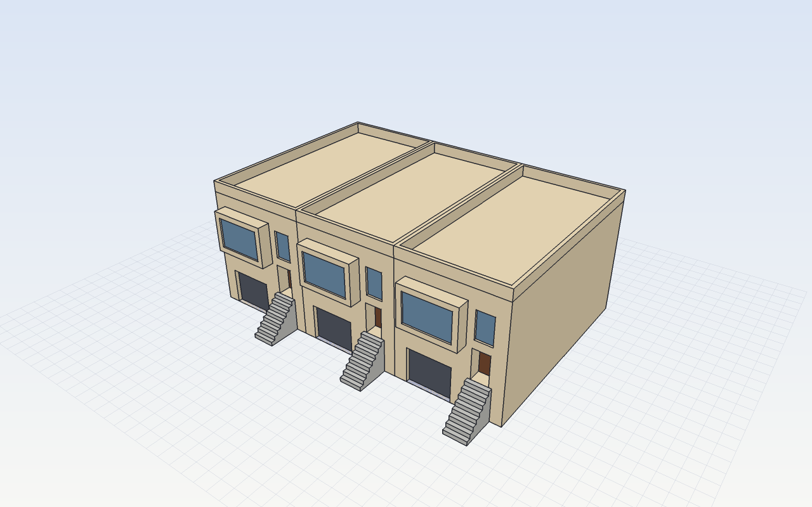

# Riseline

**Draw an outline. Pull it up.**

Riseline is a push/pull 3D modeler for buildings and streets, written in Rust.
The engine is headless: every action is a JSON command, so the desktop app,
scripts, the CLI and AI agents (over MCP) all drive the same thing.



## Try it

```sh
cargo run --release -- run examples/sunset_row_house.jsonl
open out/sunset_iso.png out/sunset_street.png
```

## Commands

One JSON object per line. Add `"as":"name"` to remember a result's id, then
use `"@name"` anywhere an id goes. Units are meters; Z is up.

| Area | Commands |
|---|---|
| Draw | `rect`, `polygon`, `line` (splits edges, cuts faces, closes loops), `circle`, `arc`, `offset` |
| Shape | `pushpull` (pull, push, carve recesses), `follow_me` (path points, edges, or `around` a face) |
| Transform | `move` (faces, edges, vertices: raise a ridge for a gable), `rotate`, `scale` (uniform or per axis), `duplicate`, `array`, `copy` |
| Organize | `begin_group`/`end_group`, `group`, `edit`/`close`, `make_component`, `place`, `explode`, `components`, `rename` |
| Library | `insert` (door, window, garage_door, tree, palm, car, streetlight, bench, hydrant), `assets` |
| Visibility | `hide`, `unhide`, `tag`, `tag_visible`, `soften` (edges, or `coplanar:true`) |
| Construction | `guide` (line or point), `clear_guides`, `save_view`, `delete_view` |
| Inspect | `pick`, `faces`, `info`, `undo`, `redo`, `new` |
| Files | `save`/`open` (.riseline), `export_obj`, `export_glb`, `export_stl`, `import_obj`, `render` (PNG, any view or saved view) |

## The app

```sh
cd app && npm install && npm run tauri dev     # desktop (Tauri)
# or in a browser:
cargo run --release -- bridge & (cd app && npx vite)   # open http://127.0.0.1:5174
```

Figma-style layout: Outliner / Library / Views on the left, Entity Info and
paint on the right, a floating toolbar with every tool, style toggles (X-ray,
shadows, edges, parallel projection) and a section cut. Keys follow the
classic push/pull modeler layout: Space select (hold to orbit), L line,
A arc, R rectangle, C circle, N polygon, P push/pull, F offset, J follow me,
M move (Option copies, then `x5` / `/5` for arrays), Q rotate, S scale,
T tape measure (guides), B paint (Option samples), E erase (Shift hides),
O orbit, X section, G group, H hide, ⇧Z zoom extents. Snapping shows
endpoints, midpoints, edges, faces and the red/green/blue axes; arrow keys
lock an axis. Type a number and press Enter for exact sizes. The model lives in `~/Documents/Riseline/live.riseline`; the app
reloads it when Claude edits it over MCP, so you can build together.

## Claude (MCP)

`.mcp.json` registers `riseline mcp` for Claude Code in this repo. Claude gets
`riseline_run` (commands), `riseline_render` (sees a PNG) and `riseline_info`,
all on the same live model as the app. Build the binary first:
`cargo build --release`.

## Import a googledriver block

```sh
python3 tools/twin_import.py ../googledriver/twin/20th-ave out/20th_ave.jsonl
cargo run --release -- run out/20th_ave.jsonl --save ~/Documents/Riseline/live.riseline
```

## Run modes

- `riseline run script.jsonl [--open f] [--save f]`: run a script.
- `riseline serve [--open f]`: JSON commands on stdin, replies on stdout.
- `riseline mcp [--doc f]`: MCP server for AI agents.
- `riseline bridge [--port 5175]`: localhost HTTP bridge for the browser UI.

## Roadmap

1. ✅ Engine, commands, headless render, OBJ export
2. ✅ MCP server so Claude can model directly
3. ✅ Desktop app (Tauri + React, Figma/Canva-style panels), live-linked to the engine
4. ✅ Inference: endpoints, midpoints, on edge/face/guide, axis locks (arrows)
5. ✅ Face splitting, line topology, auto-fold, soft edges
6. ✅ Import googledriver twin blocks (footprints, measured heights, sloped streets)
7. ✅ Components, groups (open/close), tags, hide, guides, saved views
8. ✅ Asset library: doors, windows, garage doors, trees, palms, cars, streetlights, benches, hydrants
9. ✅ glTF / STL / OBJ export, OBJ import, section cut, X-ray, shadows, parallel view
10. Next: photo match (Street View onto faces), textures, dimensions and text labels,
    solid tools (union / subtract), intersect faces, parallel/perpendicular inference
