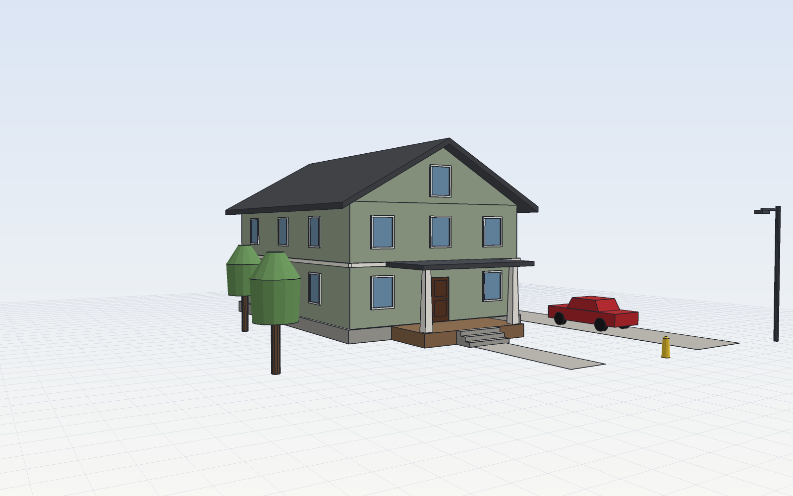

<p align="center"></p>

# SketchCraft

**A free 3D modeler for houses, rooms, furniture and anything with straight
walls.** Draw an outline, pull it up into a shape, and keep going. If you've
used SketchUp, you already know how: same tools, same shortcuts, and it opens
your SketchUp files.

It's free and open source, and runs on Mac, Windows and Linux.

<p align="center"></p>

## Download

**[Get the latest version](https://github.com/jasonsutter87/sketchcraft/releases/latest)**

| Your computer | Download |
| --- | --- |
| **Mac** (Apple silicon or Intel) | `SketchCraft_…_universal.dmg`, then drag SketchCraft to Applications |
| **Windows 10 or 11** | `SketchCraft_…_x64-setup.exe`, or the **portable ZIP** if you'd rather not install |
| **Linux** | `.AppImage` (any distro), `.deb` or `.rpm` |

The first time you open it, your computer may ask whether you trust it,
because SketchCraft isn't signed by Apple or Microsoft yet:

- **Mac:** System Settings › Privacy & Security › **Open Anyway**.
- **Windows:** **More info › Run anyway**.

After that it **updates itself**: when a new version is out, it offers to
update when you open it.

## What you can do

**Model buildings and things.** Push/pull, lines that cut faces, arcs,
circles, offsets, Follow Me, move, rotate, scale and copies. Type exact sizes
as you go (`5,4`, `8'6"`, `250cm`). Snap to corners, midpoints, centers and the
axes.

**Organize big models.** Groups inside groups, reusable components (change one,
they all change), tags like layers, and an outliner of everything.

**Start from what you have.** Open SketchUp files, AutoCAD drawings, Revit and
ArchiCAD models, and 3D scans. Turn a 2D floor plan into walls in one click.

**Show it off.** Photoreal renders, sun studies, walkthrough videos, styles from
sketchy to blueprint, section cuts and floor plans, drawing sheets at real scale.



**Plan the build.** The **Cut list** plugin lists every board to cut and roughly
how many sheets and boards to buy.

<p align="center"></p>

**Make it yours.** A SketchUp-like Classic look by default, or SketchCraft's
own themes, docked or floating tool bars, and your own tool icons.

<p align="center"></p>

## Opens your files

| | |
| --- | --- |
| **SketchUp** (`.skp`) | versions 6 to 8 and 2013 onward |
| **AutoCAD** (`.dwg`, `.dxf`) | DXF on its own; DWG with a free helper |
| **Revit, ArchiCAD** (`.ifc`) | with a free helper; SketchCraft shows how to set it up |
| **3D models** (`.fbx`, `.obj`) | |
| **3D scans** (`.ply`, `.las`, `.xyz`, `.pts`) | point clouds you can snap to |

It saves glTF, FBX, OBJ, STL (3D printing), Collada, DXF, DWG, IFC, PDF, PNG and MP4.

## New to SketchCraft?

- **In the app:** click **Learn** (top right) for short lessons that watch you
  do each step, and demos to watch. Press **?** for every shortcut, and
  **Shift+S** to find any command by name.
- **The guide:** [Getting started](docs/guide/01-getting-started.md), then
  [Drawing](docs/guide/02-drawing.md), [Shaping](docs/guide/03-shaping.md),
  [Organizing](docs/guide/04-organizing.md), [Files](docs/guide/05-files.md),
  [Presenting](docs/guide/06-presenting.md),
  [Themes](docs/guide/07-themes.md), [Plugins](docs/guide/08-plugins.md),
  [Shortcuts](docs/guide/09-shortcuts.md) and
  [Troubleshooting](docs/guide/10-troubleshooting.md).

## Questions

**Is it really free?** Yes. No account, no subscription, no watermark. It's
open source under the MIT license.

**Do I need the internet?** No. SketchCraft works offline; it only goes online
to check for updates and, if you ask, to fetch map imagery for a location.

**Is it SketchUp?** No. It's an independent project that works the same way and
reads the same files. Not affiliated with Trimble or SketchUp.

**Something isn't working.** See [Troubleshooting](docs/guide/10-troubleshooting.md),
or [tell us about it](https://github.com/jasonsutter87/sketchcraft/issues).

---

# For developers

SketchCraft is a Rust engine with a React + three.js interface in a Tauri app.
Every action is a JSON command, so scripts, plugins and AI agents drive exactly
what you drive with the mouse.

## Scripting and the CLI

```json
{"cmd":"rect","from":[0,0,0],"to":[8,12,0],"as":"lot"}
{"cmd":"pushpull","face":"@lot","distance":6}
{"cmd":"insert","asset":"door","at":[3.5,0,0]}
{"cmd":"render","out":"house.png","view":"iso"}
```

```sh
sketchcraft run house.jsonl            # run a script
sketchcraft serve                      # JSON lines in and out on stdio
sketchcraft mcp --doc model.sketchcraft
sketchcraft bridge                     # the app's UI in a browser (localhost)
```

Every command: [docs/dev/scripting.md](docs/dev/scripting.md). The CLI is in each
release as `sketchcraft-cli-<platform>.zip`.

## AI agents (MCP)

`sketchcraft mcp` gives an agent `sketchcraft_run`, `sketchcraft_render` (it
gets the picture back, so it can see what it built) and `sketchcraft_info`.
Pointed at the app's live model, you and the agent build the same thing.
[docs/dev/mcp.md](docs/dev/mcp.md)

## Plugins

Plugins are small JavaScript files that add commands, ask questions with forms,
and build or measure geometry. They run sandboxed (no network, no files).
[Writing a plugin](docs/PLUGINS.md), with the built-in
[Cut list](core/plugins/cutlist/main.js) and [Shelves](core/plugins/shelves/main.js)
as examples.

## Building from source

```sh
cargo build --release -p sketchcraft-core      # engine and CLI
cd app && npm ci && npm run tauri build         # the desktop app
```

Rust (stable) and Node.js 22. The browser dev loop, tests, demo GIF recording
and releasing: [docs/dev/building.md](docs/dev/building.md).

## How it's built

The model, commands, importers (including clean-room SketchUp readers),
exporters, a rasterizer and a path tracer live in `core/`; the interface in
`app/`. [docs/dev/architecture.md](docs/dev/architecture.md) ·
[renderer](docs/RENDERER.md) · [security](docs/SECURITY.md) ·
[SketchUp parity](docs/PARITY.md)

## Contributing

Bug reports and ideas: [issues](https://github.com/jasonsutter87/sketchcraft/issues). How to run the tests, and the rule that features land with them: [CONTRIBUTING.md](CONTRIBUTING.md).
Where SketchCraft is going, release by release: [ROADMAP.md](ROADMAP.md). What people asked for: [FEATURE-REQUESTS.md](FEATURE-REQUESTS.md).
What changed in each version: [CHANGELOG.md](CHANGELOG.md).

## License and trademarks

MIT, see [LICENSE](LICENSE). SketchCraft is an independent, clean-room project.
It is not affiliated with or endorsed by Trimble or SketchUp, or by ArtCraft.

[](https://m8ven.ai/mcp/jasonsutter87-sketchcraft-1xpwc9?s=readme)
