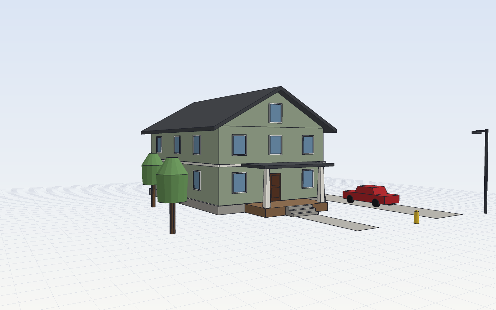
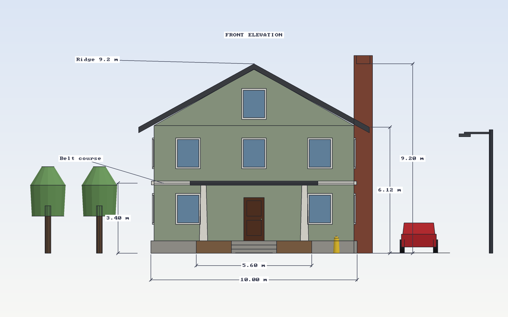

# SketchCraft

**Draw an outline. Pull it up.**

SketchCraft is a free, open-source push/pull 3D modeler for buildings, streets
and anything with straight walls. It's written in Rust, runs as a desktop app
on macOS, Windows and Linux, and is fully scriptable: every action is a JSON
command, so scripts, the CLI and AI agents (over MCP) drive exactly what you
drive with the mouse.





## What it does

- **Draw:** lines that split edges, cut faces and close into faces; rectangles,
  circles, polygons, arcs, offsets.
- **Shape:** push/pull (pull out, push in, carve windows and doors), Follow Me
  sweeps for trim, cornices and eaves, auto-fold when a move bends a face.
- **Transform:** move, copy and arrays (`x5`, `/5`), rotate, scale, mirror.
- **Snap:** endpoints, midpoints, edges, faces, guides and the red/green/blue
  axes, with "From Point" alignment and arrow-key axis locks. Type a number and
  press Enter for exact sizes.
- **Organize:** groups and components (edit one, every copy updates), tags,
  hide/unhide, soft edges, an outliner.
- **Document:** dimensions and text labels, saved views, section cuts, X-ray,
  shadows, parallel projection, headless PNG renders.
- **Library:** doors, windows, garage doors, trees, palms, cars, streetlights,
  benches and hydrants, all built from editable command scripts.
- **Files:** `.sketchcraft` documents, glTF (.glb), OBJ and STL export, OBJ import.

## Install

Download the latest build from
[Releases](https://github.com/jasonsutter87/sketchcraft/releases/latest):
a `.dmg` for macOS, `.msi`/`.exe` for Windows, and `.AppImage`/`.deb` for Linux.
The headless CLI is attached as `sketchcraft-cli-*.zip`.

macOS builds aren't notarized yet. If macOS says the app "can't be opened",
open **System Settings › Privacy & Security** and click **Open Anyway**.

### Build from source

```sh
# engine + CLI
cargo build --release -p sketchcraft-core
# desktop app
cd app && npm ci && npm run tauri build
```

Requires Rust (stable) and Node.js 22.

## The app

A Figma-style layout: Outliner / Library / Views on the left, Entity Info and
paint on the right, a floating toolbar, and style toggles.

| Key | Tool | Key | Tool |
|---|---|---|---|
| Space | Select (hold to orbit) | M | Move (Option copies) |
| L | Line | Q | Rotate |
| A | Arc | S | Scale |
| R | Rectangle | T | Tape measure (guides) |
| C | Circle | D | Dimension |
| N | Polygon | W | Text |
| P | Push/Pull | B | Paint (Option samples) |
| F | Offset | E | Erase (Shift hides) |
| J | Follow Me | O | Orbit |
| X | Section cut | G / H | Group / Hide |

Arrow keys lock the red (→), green (←) or blue (↑) axis. Middle-drag orbits,
right-drag pans, right-click opens the context menu, ⇧Z zooms to fit.

## Scripting and the CLI

One JSON command per line. Add `"as":"name"` to remember a result's id and use
`"@name"` later. Units are meters; Z is up.

```json
{"cmd":"rect","from":[0,0,0],"to":[8,12,0],"as":"lot"}
{"cmd":"pushpull","face":"@lot","distance":6}
{"cmd":"insert","asset":"door","at":[3.5,0,0]}
{"cmd":"dimension","from":[0,-1,0],"to":[8,-1,0],"offset":[0,0,-1]}
{"cmd":"render","out":"house.png","view":"iso"}
```

```sh
sketchcraft run examples/craftsman_house.jsonl     # run a script
sketchcraft serve                                  # JSON in, JSON out on stdio
sketchcraft mcp --doc model.sketchcraft            # MCP server for AI agents
sketchcraft bridge                                 # the app's UI in a browser
```

| Area | Commands |
|---|---|
| Draw | `rect`, `polygon`, `line`, `circle`, `arc`, `offset` |
| Shape | `pushpull`, `follow_me` |
| Transform | `move`, `rotate`, `scale`, `duplicate`, `array`, `copy` |
| Organize | `begin_group`/`end_group`, `group`, `edit`/`close`, `make_component`, `place`, `explode`, `components`, `rename` |
| Library | `insert`, `assets` |
| Visibility | `hide`, `unhide`, `tag`, `tag_visible`, `soften` |
| Notes | `dimension`, `text`, `guide`, `clear_guides`, `save_view`, `delete_view` |
| Inspect | `pick`, `faces`, `info`, `undo`, `redo`, `new` |
| Files | `save`, `open`, `export_obj`, `export_glb`, `export_stl`, `import_obj`, `render` |

## AI agents (MCP)

`sketchcraft mcp` exposes `sketchcraft_run`, `sketchcraft_render` (returns an
image the agent can look at) and `sketchcraft_info`. With `--doc` it shares the
desktop app's live model, so you and an agent can build the same model at once.
This repo's `.mcp.json` sets it up for Claude Code.

## Status

Young and moving fast. Next up: photo match (project photos onto faces),
image textures, solid tools (union/subtract), intersect faces, and parallel /
perpendicular inference.

## License and trademarks

MIT, see [LICENSE](LICENSE). SketchCraft is an independent, clean-room project:
it is not affiliated with or endorsed by Trimble or SketchUp, or by ArtCraft.
