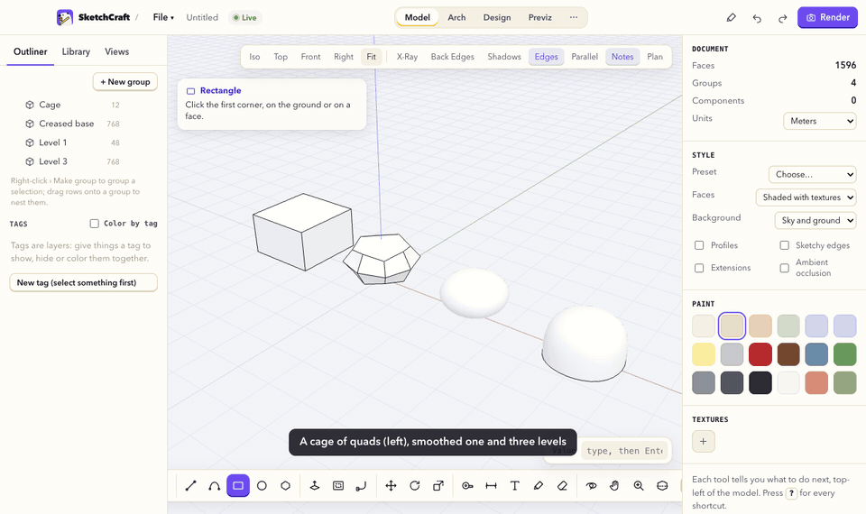
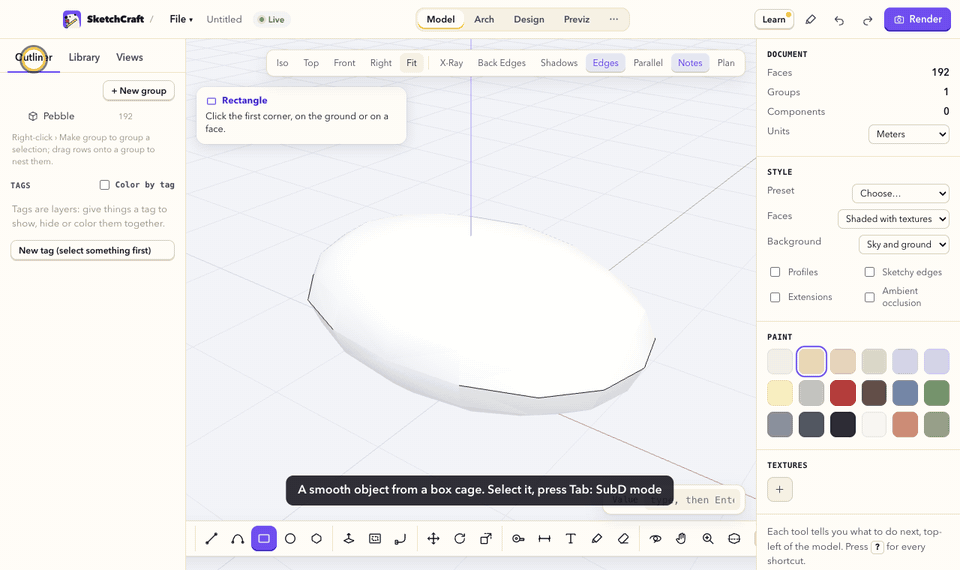
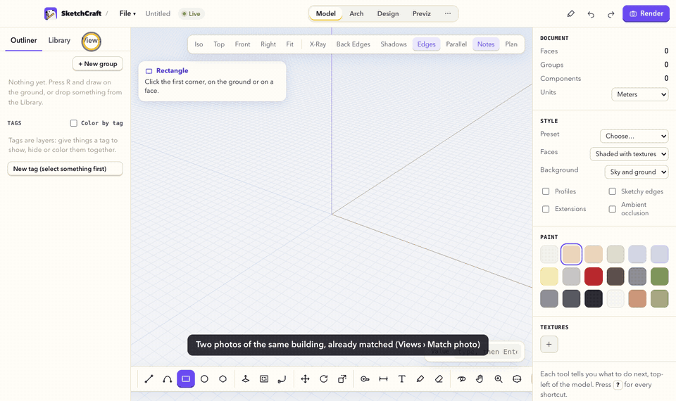

# 3. Shaping

## Push/Pull (P)

Click a face and move: it grows into a solid, or cuts in when you push. Push
a window outline right through a wall to make a hole. Type a distance for an
exact one.

## Move, Rotate, Scale

| Tool | Key | Notes |
| --- | --- | --- |
| Move | M | Option/Ctrl makes a copy; type `x5` after for five copies |
| Rotate | Q | click the center, a start direction, then the angle (snaps to 15°) |
| Scale | S | drag a handle; type `2` for twice the size |
| Offset | F | a face's outline, moved in or out |
| Follow Me | J | sweep a shape along a path: trim, cornices, gutters |

### Move a single corner

With nothing selected, Move grabs the corner under the cursor. Its edges
stretch as you go, and the faces around it fold so every face stays flat. Good
for roofs, ramps and tapered shapes.

## Solids and more

Select two solids (closed groups or components) and right-click: **Union**,
**Subtract**, **Intersect**, **Trim**, **Split** or **Outer shell**. Also:
**Intersect Faces**, **Flip Along**, **Soften** edges, and **Bevel** in the
Design workspace.

## Curved and organic shapes

**Subdivision** smooths a rough cage of faces into a soft shape, the way
Blender's Subdivision modifier does. There are two ways to start one, both in
the app:

- **SubD box**: a cube cage, ready to shape. Library › Smooth shapes (SubD) ›
  SubD box, or right-click empty space › SubD box (or Shift+S, type *SubD*).
- **Subdivide…** on something you already modeled: select a group or component,
  right-click › Subdivide… (or Library › Smooth shapes › Subdivide…). Choose how
  smooth (1 light, 2 usual, 3 very smooth) and whether sharp edges stay sharp,
  then Subdivide. A component is made a group first (just that one). Faces with
  holes can't be subdivided: split them first.

Either way you land in SubD mode on the object's cage. Drag points, edges or
faces; the smooth surface follows. **Tab to shape, Enter when done**: Enter
leaves SubD mode, and later, select the object and press Tab (or double-click
it) to shape it again. Undo takes back the Subdivide in one step.

Inside SubD mode, 1, 2 and 3 pick points, edges or faces; L adds a loop, E
extrudes, C creases; Tab switches between the cage and the smooth surface.

## Pictures on shapes (projection mapping)

Add a picture in the **Materials** panel (the **+** under Textures), select the faces, group or component it should go
on, and choose **Tools › Project texture…** (also in the right-click menu and the command search). A small panel opens
beside the model and the picture appears at once:

- **Planar** shines the picture straight through the selection, like a slide projector (from where you are looking, or
  from above, the front or the right).
- **Box** gives every face the flat side of an imaginary box that fits it best: good for crates, dice and walls.
- **Cylinder** wraps the picture once around, like the label on a can; the ends get it flat.
- **Sphere** wraps it like a map on a globe.

**Size** and **Turn** change it as you watch (on a cylinder or sphere, Turn moves the seam), **Fit once** makes the
picture cover the selection exactly once instead of repeating at its own size, and **Axis and center…** moves the
projection. **Apply** keeps it (one Undo takes it back), **Cancel** drops it, **Remove projection** goes back to the
picture's own placement. The result is saved with the model and goes into glTF, OBJ and Collada exports. A model that
uses it is saved so that older SketchCraft versions open it read-only rather than lose it.

## Moving a picture on a face (Position Texture)

Right-click a face that has a picture and choose **Texture › Position** (or **Tools › Position texture…**). The whole
picture appears see-through over the face, with four pins on its corners:

- **Red** moves the picture. So does dragging the picture itself.
- **Green** scales and turns it around the red pin.
- **Blue** stretches or leans its height.
- **Yellow** skews it.

The face follows as you drag. Press **Enter** (or click empty space) to keep the result as one Undo step, **Esc** to take it
back. Right-click inside for **Flip left/right**, **Flip up/down**, **Rotate 90/180/270**, **Reset** and **Done**. You can
still orbit by dragging away from the picture. It works on faces painted with the Paint Bucket, carried on by paint-through
or laid by a projection. The yellow pin skews rather than bending the picture in perspective.

## Terrain

The Sandbox tools shape ground: **Smoove** raises and lowers it, **Stamp**
presses in a flat pad for a building, **Drape** lays lines onto it, and
**Flip edge** fixes a triangle. **Add location…** brings in real terrain and
map imagery.

## Model from photos

Match two photos of the same building, mark the same corners in both, and
SketchCraft works out where they are in 3D. Views › Match photo…, then Model
from photos…

Next: [Organizing](04-organizing.md)
