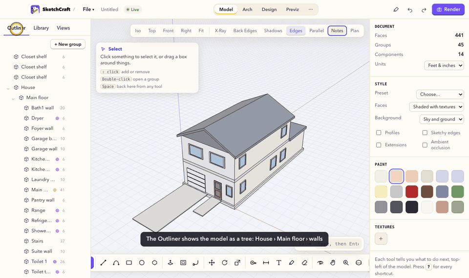

# 4. Organizing

## Groups

Select some geometry and right-click it › **Make group** (also **Edit › Make group**, and **Make group** in the
right panel). A group moves and hides as one, and nothing outside it sticks to it. Right-click always opens the menu on
what is under the pointer, selecting it first if nothing is selected; with the keyboard, **Shift+F10** (or the Menu key)
opens it for the current selection. Double-click a
group to open it and edit inside; Esc or a click outside closes it.

Groups can sit inside groups: a House holding a Main floor and an Upper floor.
In the **Outliner** (left panel), drag a row onto a group to put it inside, or
select several and right-click › **Make group**.

## Components

A component is a group that's reused: edit one, and every copy changes. Select
and right-click › **Make component…** (or press **G**). Doors, windows, trees, cars and people
in the **Library** are components.

- **Cuts an opening where placed**: doors and windows cut their hole in the wall
  you place them on.
- **Always faces the camera**: flat figures (people, trees) turn to face you.
- **Component Options**: components with attributes (sizes, formulas) can be
  changed from the right panel, like SketchUp's Dynamic Components.

## Tags

Tags are like layers. Select something and give it a tag in the Outliner, then
hide, show, solo or color everything with that tag. **Color by tag** paints the
model by tag so you can check what's where.

## Hiding

- The eye on an Outliner row hides that thing (and everything inside it).
- The Eraser with **Shift** hides an edge instead of deleting it.
- **Hide rest of model**: while editing a group, show only what you're editing.

## Scale figures

New models start with a person at the origin (Document › Scale figure: a
person, the SketchCraft beaver, or nobody). Both are in the Library too. They
are flat cutouts that always face you, and renders turn them to the camera.

Next: [Files](05-files.md)
