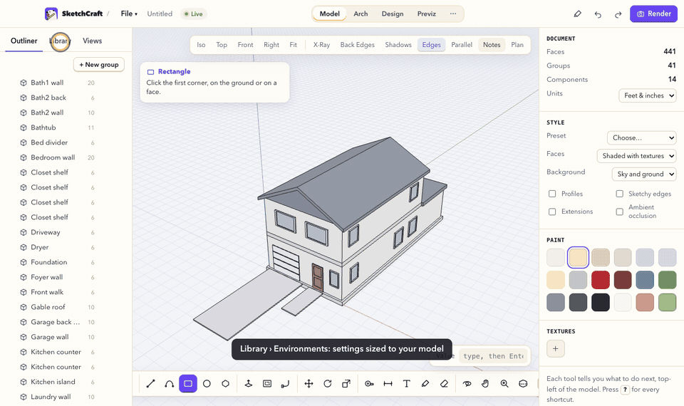
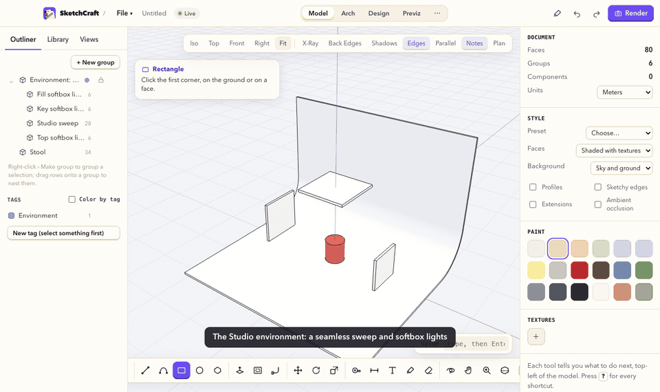

# 6. Presenting

## Styles

**Style** in the right panel: shaded, shaded with textures, physically based,
monochrome, hidden line or wireframe, on a sky, paper, blueprint or night
background. Add profiles, sketchy edges, extensions or ambient occlusion. The
**Preset** list has ready-made looks.

## Scenes

In the **Views** tab, name the view and click **Save**: it remembers the camera,
and the style, hidden things, tags and section cut that go with it (in the
Previz strip, **+ Scene** does the same). Click a saved view to glide back.

## Sections and plans

**X** (Section cut) and click a face to slice the model open. **Plan** in the
view bar cuts a floor plan; in the **Arch** workspace, the floor buttons cut
each floor.

## Settings around the model

**Library › Environments** (or Setting in the Arch and Previz strips) puts the
model on a suburban lot, a city block, a park, a desert or a waterfront.

## Photoreal renders

**Render** (top right) makes a photoreal picture that sharpens while you
watch. Pick a quality, place the sun (for this view, by hand, or the real sun at
a date and time), and **More settings** has size (HD, 4K, square, portrait,
custom), exposure, sunlight, sky light, sun color, light bounces, a plain
background color and the ground. **Finish** in the right panel sets each
material: matte, satin, gloss, metal, glass, glow.

## Video and sun studies

The **Timeline** (Previz workspace) makes turntables, walkthroughs and sun
studies, exported as MP4.

## Drawings

**File › Make blueprint (PDF)** and **Drawing sheets (PDF)** lay out views at
true scale with a title block. Plans, elevations, sections and parallel 3D views are
drawn as crisp vector lines with the hidden lines removed (add `"beyond": true` to a
viewport in `sheets`/`export_sheets` to show them dashed), so they stay sharp at any size
and print or open in a CAD program. Sheets come in A4 to A0, Letter, Tabloid, ARCH A to E
and ANSI C to E; a scale is `1:100` or imperial like `1/4"=1'-0"`. Line weights are pens
in paper millimeters (0.13 to 0.5), so they don't change with the scale. The `export_sheets`
command writes a `.pdf` (every page), or one page as `.svg` or `.dxf` (`"page": 2`).

Next: [Themes and workspaces](07-themes.md)
